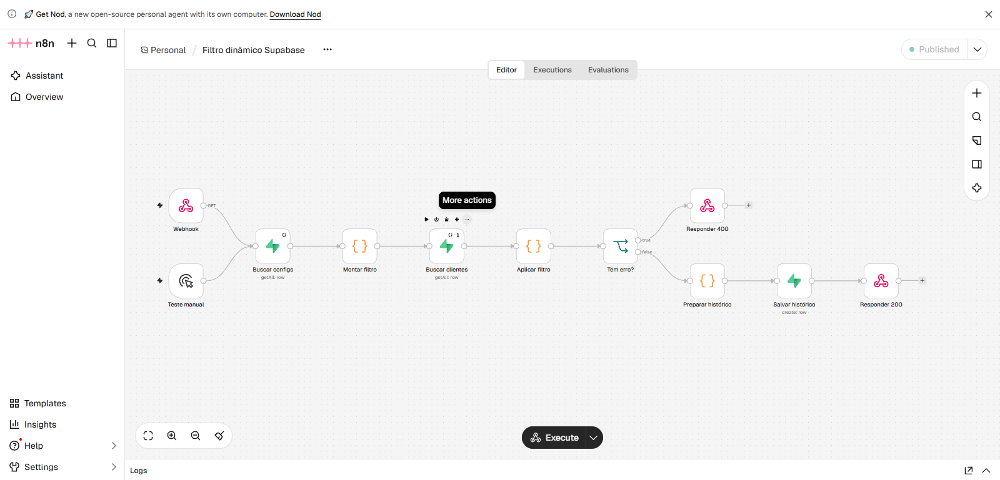

# Filtro dinâmico de dados com n8n e Supabase

Fluxo no n8n que lê registros de uma tabela no Supabase (PostgreSQL) e filtra por uma chave configurável. O campo, o operador e o valor do filtro vêm de uma tabela de configuração ou da própria URL, então trocar o filtro não exige editar o fluxo. Cada execução fica registrada em JSON no banco.



## Como funciona

```
GET /webhook/filtrar
        │
        ▼
Buscar configs ──► Montar filtro ──► Buscar clientes ──► Aplicar filtro ──► Tem erro?
 (config_filtro)   URL > nome > ativa     (clientes)                          │
                                                                    sim ◄─────┴────► não
                                                                     │                │
                                                              Responder 400   Salvar histórico
                                                                                      │
                                                                               Responder 200
```

A prioridade do filtro é:

1. Parâmetros na URL (`campo`, `operador`, `valor`)
2. Config pedida pelo nome (`?config=ticket-alto`)
3. Config marcada como `ativo = true` em `config_filtro`

Operadores aceitos: `igual`, `diferente`, `contem`, `maior`, `menor`. Texto é comparado sem diferenciar maiúsculas e acentos; `maior` e `menor` comparam como número.

## Tabelas

| Tabela | Uso |
| --- | --- |
| `clientes` | Dados a filtrar (25 registros fictícios no seed) |
| `config_filtro` | Filtros salvos; no máximo um com `ativo = true` |
| `historico_filtros` | Uma linha por execução, com o filtro em `jsonb` e o total |

## Configuração

Pré-requisitos: Docker e uma conta no [Supabase](https://supabase.com) (o plano gratuito basta).

1. No Supabase, abra o SQL Editor e rode `supabase/schema.sql` e depois `supabase/seed.sql`.
2. Copie o arquivo de ambiente e defina uma chave qualquer para o n8n:
   ```
   cp .env.example .env
   ```
3. Suba o n8n:
   ```
   docker compose up -d
   ```
4. Importe o fluxo:
   ```
   docker compose exec n8n n8n import:workflow --input=/home/node/fluxos/filtro-dinamico.json
   ```
5. Em http://localhost:5678, crie o usuário local, abra o fluxo e crie uma credencial **Supabase API** com a URL do projeto e a chave `service_role` (Project Settings > API). Selecione essa credencial nos três nós do Supabase.
6. Publique (ative) o fluxo.

## Exemplos de uso

As chamadas estão em `exemplos/requisicoes.http` e as respostas em `exemplos/respostas/`.

```
curl "http://localhost:5678/webhook/filtrar"
curl "http://localhost:5678/webhook/filtrar?config=ticket-alto"
curl "http://localhost:5678/webhook/filtrar?campo=cidade&valor=porto%20alegre"
```

Resposta:

```json
{
  "filtro": { "campo": "cidade", "operador": "igual", "valor": "porto alegre", "origem": "url" },
  "total": 5,
  "registros": [ { "id": 1, "nome": "Mercado Bom Preço", "cidade": "Porto Alegre", "...": "..." } ],
  "geradoEm": "2026-11-09T17:00:00.000Z"
}
```

Campo inexistente ou operador inválido devolve status 400 com a lista do que é aceito.

## Trocando o filtro sem mexer no fluxo

Pela tabela, desativando o filtro atual e ativando outro:

```sql
update config_filtro set ativo = false where ativo;
update config_filtro set ativo = true where nome = 'clientes-poa';
```

Ou pela URL, que tem prioridade sobre qualquer config: `?campo=plano&valor=empresa`.

## Segurança

- A chave `service_role` fica só na credencial do n8n, nunca no repositório.
- RLS habilitado nas três tabelas, sem políticas públicas: a chave pública do Supabase não lê nada.
- O `.env` está no `.gitignore`.

## Limitações

O filtro roda em memória no n8n depois de ler a tabela inteira. Para alguns milhares de registros funciona bem; acima disso, o caminho é levar o filtro para a própria consulta no Supabase.
